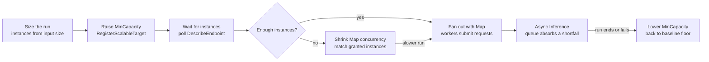

# SageMaker Inference Capacity Planning

Applied scenario from work, related to [long-running-tasks.md](long-running-tasks.md). As of 2026-11-03.

## Summary

Autoscaling alone does not guarantee we get instances. Every scale-out is a request for on-demand capacity, and AWS can turn it down even when we are under quota. The answer is to own the baseline, size the peak from measured throughput, and have the pipeline scale the endpoint up before it sends load.

- **Will instances be available?** Not guaranteed. The ceiling is the lowest of our `MaxCapacity`, the SageMaker per-instance-type quota minus what we already run, and what AWS has free in the region. Only the instances we already hold, or have reserved, are certain.
- **How many do we need?** Peak request rate divided by (measured per-instance throughput × target utilization). The pipeline's fan-out (Map and Batch concurrency) sets the peak rate.
- **What to do:** keep `MinCapacity` at the baseline, scale up from Step Functions before fan-out, and put Async Inference in front so a shortage slows the pipeline instead of failing it.

## Context

Workflow as a Service (WaaS) uses Step Functions and AWS Batch to run Metaflow pipelines. Pipeline steps call a SageMaker real-time endpoint that serves a deep learning model on GPU instances. Application Auto Scaling adds or removes endpoint instances as load changes.

Two properties of this setup shape the answer:

- **Load arrives in bursts.** A pipeline run fans out many workers at once, so load can jump from zero to peak in seconds. GPU instances take minutes to come up.
- **Demand is known ahead of time.** The workflow knows its input size before it calls the model, so it can request capacity before it needs it.

SageMaker endpoint instances count against **SageMaker** quotas, not EC2 vCPU quotas. Batch jobs on EC2 GPU instances do not use up the endpoint's quota.

## What caps scale-out

The endpoint can grow only to the lowest of these limits. Our config sets the first one, AWS sets the others, and only the first two show up anywhere in our settings.

| Limit | Who sets it | Where it lives | What happens when we hit it |
|---|---|---|---|
| Autoscaling `MaxCapacity` | Us | Application Auto Scaling scalable target for the variant | Scaling stops quietly; latency and errors go up |
| Endpoint instance quota (e.g. "ml.g5.2xlarge for endpoint usage") | AWS, per instance type, per region; can be raised | Service Quotas, service code `sagemaker` | Scale-out fails with a `ResourceLimitExceeded` error |
| What other endpoints already run | Other endpoints and teams in the account | Sum of `CurrentInstanceCount` across endpoints of that type | Same as above; the quota is shared account-wide |
| AWS capacity in the region and AZs | AWS; there is no API to check it | Shows up only when a scale-out fails | Scale-out fails with an insufficient capacity error, even under quota |
| Subnet IPs (VPC endpoints only) | Us | Free IPs in the endpoint's subnets | New instances cannot attach |

The quota grants permission to launch instances, not a reservation. GPU types (g5, g6, p4d, p5) are the ones most likely to hit the capacity limit.

## Checking headroom today

Headroom = min(`MaxCapacity`, quota − instances already running of that type) − our current count. These commands give each number.

1. Our autoscaling limits (`MinCapacity`, `MaxCapacity`):

   ```bash
   aws application-autoscaling describe-scalable-targets \
     --service-namespace sagemaker \
     --resource-ids endpoint/<endpoint-name>/variant/<variant-name>
   ```

2. The account quota for our instance type:

   ```bash
   aws service-quotas list-service-quotas --service-code sagemaker \
     --query "Quotas[?QuotaName=='ml.g5.2xlarge for endpoint usage'].[QuotaName,Value]"
   ```

3. Instances of that type already running across all endpoints in the region:

   ```bash
   for ep in $(aws sagemaker list-endpoints --query 'Endpoints[].EndpointName' --output text); do
     aws sagemaker describe-endpoint --endpoint-name "$ep" \
       --query "ProductionVariants[].[CurrentInstanceCount]" --output text
   done
   ```

   This lists counts per variant. Match each variant to its instance type with `describe-endpoint-config` before adding them up.

4. Past scale-out failures, the only record of capacity problems:

   ```bash
   aws application-autoscaling describe-scaling-activities \
     --service-namespace sagemaker \
     --resource-id endpoint/<endpoint-name>/variant/<variant-name>
   ```

   Look for `StatusCode: Failed` and a `StatusMessage` that mentions capacity or a resource limit. There is no API that tells us ahead of time whether AWS has free GPUs.

## How many instances we need

The instance count comes from two measurements: what one instance can handle, and the peak request rate the pipeline sends.

```
instances = ceil(peak requests/s / (R × u))
```

- **R, per-instance throughput:** the highest request rate one instance sustains while still meeting the p99 latency target. Measure it with a load test using real payloads and batch size; GPU throughput depends heavily on batching. SageMaker Inference Recommender can run this test.
- **u, target utilization:** 0.6 to 0.7, which leaves room for bursts.
- **Peak requests/s:** concurrent workers × requests per worker per second. Step Functions Map `MaxConcurrency` and the Batch compute environment's `maxvCpus` limit how many workers run at once. Confirm against history: CloudWatch `Invocations` and `ConcurrentRequestsPerModel` for the endpoint.

**Example with made-up numbers:** a peak of 50 requests/s, one instance handling 8 requests/s, and a 0.7 target gives ceil(50 / 5.6) = 9 instances. Set `MaxCapacity` at least that high, check the quota covers it, and add whatever other endpoints use.

**Scale-out takes too long for this traffic.** A new GPU instance must launch, pull the container, load the model, and pass health checks, which takes minutes. A pipeline that jumps to peak right away runs short of capacity for that whole window. Reactive target tracking cannot close that gap, so we scale up before the load arrives (see Recommended design).

## Getting capacity when we need it

The only capacity we can count on is capacity we already hold. Everything above that is best-effort, and the options trade cost for certainty.

| Option | Guaranteed? | Cost | Use it for |
|---|---|---|---|
| Keep a floor running (`MinCapacity`) | Yes, while running | Pay for idle instances | Baseline load we never drop below |
| SageMaker reserved capacity (training plans for inference) | Yes, for the reserved window | Paid up front for the window | Large, scheduled pipeline runs; check that our instance type and region are supported |
| Scale up ahead of the run | Partly; we find out minutes before, not mid-run | Pay only during the run | Every known pipeline run |
| Endpoint subnets in several AZs | No; fewer failures | None | Always (VPC endpoints) |
| A second production variant on another GPU type (e.g. g5 and g6) | No; a fallback | Some extra config | Fallback when one type is short |
| Quota increase | No; permission only | None, but takes days | Set above peak plus other endpoints, ahead of launches |

The options stack: a running floor for the baseline, reserved or pre-scaled capacity for known peaks, and flexible types and AZs for whatever is left.

## Recommended design

Keep a baseline floor running all the time, and have each workflow request its peak capacity before it fans out. Async Inference in front of the endpoint turns a capacity shortfall into a queue instead of failed requests.



The workflow learns whether it has enough capacity before it sends load. If it doesn't, it slows down on purpose instead of overloading the endpoint.

1. **Baseline floor.** Set `MinCapacity` to the steady load we always have. Those instances are always ours.
2. **Size the run.** The first state computes the instances needed from the input size, using the formula above.
3. **Raise `MinCapacity`.** Call `applicationautoscaling:registerScalableTarget` through the Step Functions SDK integration. Raising the floor, rather than setting a desired count directly, keeps target tracking from scaling in during the run.
4. **Wait for instances.** Poll `sagemaker:describeEndpoint` until `EndpointStatus` is `InService` and `CurrentInstanceCount` reaches the target. Set the timeout from measured scale-out time.
5. **Not enough?** Set Map concurrency to what the granted instances can serve (`MaxConcurrencyPath` reads it from state input), then retry the scale-up later. Fail fast only if the run has a hard deadline.
6. **Async Inference.** Workers call `InvokeEndpointAsync`, and requests wait in SageMaker's internal queue. Scale on `ApproximateBacklogSizePerInstance`.
7. **Lower `MinCapacity`.** Do this in the last state and in a `Catch` handler, so failed runs also release capacity.

**Overlapping runs.** If two runs each set `MinCapacity` to their own number, the second overwrites the first. Keep a shared count of capacity requested by active runs (e.g. a DynamoDB counter), and set `MinCapacity` to baseline + that total.

## Monitoring and alarms

Alarm on capacity running short, not only on latency. By the time latency goes up, the pipeline is already behind.

| Signal | Source | Alarm when |
|---|---|---|
| Instances granted vs. requested at pre-scale | Custom metric from the Step Functions pre-scale step | Granted < requested |
| Failed scaling activities | `describe-scaling-activities`, or EventBridge events for the endpoint | Any failure mentioning capacity or a resource limit |
| Quota usage | Service Quotas usage metric where available, otherwise the headroom script on a schedule | Above 80% of the quota |
| Backlog with no instances | Async Inference `HasBacklogWithoutCapacity` | Equals 1 |
| Backlog per instance and oldest request age | Async Inference `ApproximateBacklogSizePerInstance`, `ApproximateAgeOfOldestRequest` | Above what the pipeline's deadline allows |
| Latency and errors | `ModelLatency`, `Invocation5XXErrors`, `GPUUtilization` | p99 above target; errors above zero for several minutes |

## Open questions

- [ ] Which instance type and region does the endpoint use, and what is its current endpoint quota?
- [ ] What does one instance sustain at our p99 target (R)? Needs a load test.
- [ ] What are peak Map `MaxConcurrency` and Batch `maxvCpus` for the largest pipeline, and requests per worker?
- [ ] Is the use case latency-sensitive, or offline? If offline, Async Inference or Batch Transform may replace the real-time endpoint.
- [ ] Which other endpoints in the account share this instance type's quota?
- [ ] What is our tolerance when capacity is short: wait, run with fewer workers, or fail?

## Interview-ready lines

- "Autoscaling max is the limit we set, quotas are the limit AWS sets, and capacity is what AWS actually has. Plan against the lowest."
- "Size from measured per-instance throughput and peak concurrency, then reserve the baseline and pre-scale for known runs."
- "Put a queue in front so a capacity shortage slows us down instead of failing the run."
